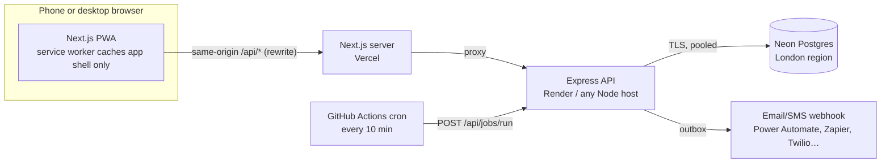
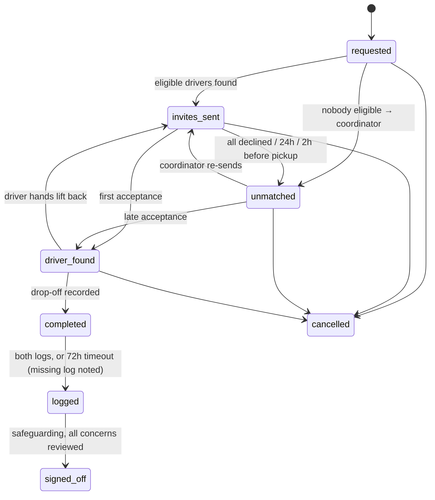
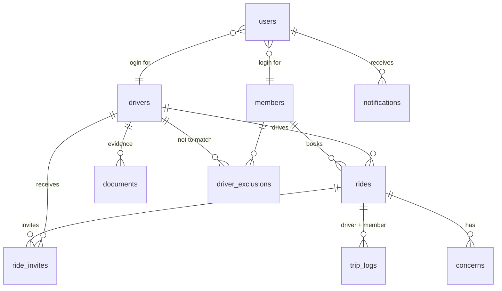

# Architecture — PSEBC Lifts (release 1)

## 1. Requirements that shaped the design

| Driver (PRD) | Design response |
| --- | --- |
| Only approved, in-date drivers may be invited (goal 1, story 1.3) | Matching is a pure, unit-tested function in `@psebc/shared`; approval is re-checked at the moment of acceptance |
| First acceptance wins (3.2) | Row lock on the ride (`SELECT … FOR UPDATE`) **and** a partial unique index `one_accepted_invite_per_ride` |
| Special-category health data (§9) | Field-level AES-256-GCM encryption, minimum-necessary views, access ends at sign-off, audit of every view |
| Audit trail of who saw and changed what (§4) | Append-only `audit_log` table (update/delete blocked by trigger), written in the same transaction as the change |
| Members without smartphones (goal 3, 2.2) | Office books on their behalf; notifications fall back to SMS or a phone-call task for the office |
| Zero budget, volunteer-run (§1, §10) | Free tiers: Neon, Render/any Node host, Vercel; no paid SaaS; plain SQL; settings table for thresholds |
| Phone + desktop, WCAG 2.2 AA (§10) | One PWA: phone layouts for members/drivers, desktop layouts for office/safeguarding; rem sizing, 44–58 px targets |

## 2. Containers



* The browser only talks to the web origin; `/api/*` is rewritten to Express, so the session cookie is
  first-party, `httpOnly`, `SameSite=Lax` (works inside installed iOS/Android PWAs).
* The API is **stateless** (JWT session cookie + per-request user lookup), so it scales horizontally.
* Background checks run in-process (`node-cron`) and can also be triggered externally; every job is
  idempotent, so running both is safe.

## 3. API structure

```
apps/api/src
  app.ts                 express app: helmet, CORS, JSON limits, no-store caching, routers, error handler
  config/env.ts          Zod-validated environment
  db/schema.ts           Drizzle ORM schema — tables, enums, indexes, checks (source of truth)
  db/client.ts           Drizzle client on a pg pool (Neon TLS), withTx(), Executor type
  db/sql.ts              fully-qualified column helper + shared correlated subqueries
  db/migrate.ts, seed.ts drizzle-kit migrations runner (../drizzle/*.sql) and demo data
  middleware/auth.ts     session cookie, per-request user load, requireRole / MFA gate
  services/audit.ts      append-only audit writer
  services/notify.ts     notification outbox + delivery adapters (console | webhook)
  modules/
    auth/                login, logout, me, TOTP setup/verify
    members/             F01 registration, F12 needs + consent, F13 close
    drivers/             F02 registration, F03 decision, evidence upload, driver home
    rides/               F04 request, F05 cancel/rebook, F06 accept/decline, F07 progress, F08/F09 logs
                         matching.service.ts — applies the shared rules to live data
                         views.ts — role-aware projections (member / invite / driver trip / record)
    concerns/            F10 report, review
    signoff/             F11 queue, trip record, sign-off
    reports/             7.1 monthly figures + CSV
    office/              church-office overview (needs attention, week's lifts)
    admin/               logins, audit viewer, settings, account closure service
  jobs/                  unmatched alert, 72h timeout, expiry, reminders, retention, outbox flush
```

Each module owns its routes and queries (Drizzle query builder); cross-module calls go through exported service functions
(e.g. `closeDriverAccount` re-runs `matchAndInvite`). Business rules that both apps need live in
`packages/shared` so the UI and API can never disagree on labels, statuses or validation.

## 4. Ride lifecycle (PRD §8)



Transitions are enforced by `assertTransition()` (shared) and by `status` guards in the update queries.

## 5. Matching rules (story 3.1)

`findEligibleDrivers(member, ride, drivers)` in `packages/shared/src/matching.ts` — all must be true:

1. Status **Approved** and approval, DBS renewal and insurance all in date on the ride date.
2. Vehicle fits: easy-access / wheelchair space / walking frame; seats for a carer or companion.
3. Driver has said they can give each kind of help needed (door, car, lifting a wheelchair) — story 1.6.
4. No other accepted ride within 90 minutes of the pickup or the lift home.
5. Not excluded for this member by safeguarding.

Every eligible driver is invited at once. The reasons drivers were *not* eligible are written to the
audit log and feed the "why no driver was found" report.

## 6. Data model



* `members.health_enc` — encrypted JSON `{flags, unwellInstructions}`; nothing else holds health data.
* `ride_invites` — unique `(ride_id, driver_id)`; partial unique index guarantees one accepted invite.
* `audit_log` — `bigserial`, JSON details, trigger rejects UPDATE/DELETE.
* `notifications` — doubles as the delivery outbox (`delivered`, `attempts`, `last_error`).
* `settings` — thresholds a volunteer can change without code (unmatched hours, timeout, office phone).

## 7. Security and privacy

| Control | Where |
| --- | --- |
| Individual logins per role, bcrypt (cost 12), lockout after 5 failures, rate-limited login | `modules/auth` |
| TOTP multi-factor for admin + safeguarding; API refuses their requests until passed | `middleware/auth.ts` |
| Immediate logout on account close / password reset (`token_version` checked per request) | `middleware/auth.ts` |
| Role checks on **every** endpoint, plus ownership checks (own member, assigned driver) | each router |
| Driver sees member details only while ride is `driver_found`/`completed`/`logged` | `rides/views.ts` |
| Invite shows postcode area + needs labels only — no name, address or health | `rides/views.ts` |
| Concerns readable by safeguarding only | `concerns/routes.ts` |
| Reports contain counts only; per-member names behind `REPORTS_SHOW_MEMBER_NAMES` (DPIA task 8.12) | `reports/service.ts` |
| Health fields encrypted at field level + Neon encryption at rest; TLS to Neon | `lib/crypto.ts`, `db/pool.ts` |
| No API response is cached by the service worker or shared caches (`Cache-Control: no-store`) | `public/sw.js`, `app.ts` |
| Logs never contain request bodies; health keys redacted | `lib/logger.ts` |
| Retention: closed accounts anonymised after the deletion date; trip logs kept | `jobs/tasks.ts` |

## 8. Scalability and operations

* **Every list is paginated.** Request `?page=N&pageSize=M` (defaults 1 and 20, maximum 100; audit trail
  defaults to 50). Responses keep their list key and add `pagination`:
  `{ page, pageSize, total, totalPages, hasNext, hasPrevious }`. Ordering always ends with the row id, so
  pages are stable and nothing is skipped or repeated. Filters (`q`, `status`, `view`, `stage`, `entityType`)
  work together with paging. Helper: `apps/api/src/lib/pagination.ts`; web: `components/pager.tsx`.
  Paginated endpoints: `/members`, `/drivers`, `/admin/users`, `/admin/audit`, `/concerns`, `/notifications`,
  `/safeguarding/queue`, `/office/overview` (week's lifts), `/rides/history`. The office "needs attention"
  lists are capped at 50 each (work to do now, not to browse).
* **Fair-use request limit** on the whole API: 300 requests a minute per signed-in person, 60 per IP when
  signed out (plus the stricter login limit). Over the limit returns 429 with a plain-English message and
  `RateLimit` headers. In-memory per instance; move to a shared store (e.g. Redis) if the API runs on
  several machines.

* **Stateless API** → run more instances behind a load balancer; Neon's pooled endpoint absorbs connections.
* **Indexes** on every hot query (rides by status/member/driver/pickup, open concerns, outbox).
* **Transactions everywhere state changes**, with notifications written in the same transaction (outbox),
  so a crash can never leave a lift accepted without the member being told.
* **Idempotent jobs** can run from several instances or an external cron.
* **Swappable adapters**: notification sender (console → webhook → Twilio/Gov.Notify), document storage
  (Postgres `bytea` today → object storage later) behind one function each.
* **Health check** `GET /api/health` (DB round-trip) for uptime monitors.
* **Migrations** are generated from the schema by drizzle-kit (`apps/api/drizzle/`) and applied automatically on API start. Things drizzle-kit can't express (the audit-log trigger, default settings) live in a custom migration.

## 9. Decisions and trade-offs

| Decision | Why | Revisit when |
| --- | --- | --- |
| Next.js + separate Express API (not Next API routes) | Matches the brief; clean boundary; API can be reused by other clients | — |
| Drizzle ORM (on the `pg` driver) | Typed queries and a single schema file, while staying close to SQL: row locks (`.for('update')`), partial unique indexes and `jsonb` work natively; analytics use typed `sql` fragments | — |
| Documents in Postgres | Zero budget, one backup to manage, small files (≤5 MB) | volume grows → S3/R2 |
| JWT cookie + DB lookup per request | Stateless scaling with instant revocation | very high traffic → short-lived cache |
| SMS/email via webhook adapter | Church's provider is undecided (M365 dependency, PRD §11) | provider chosen |
| Hand-written service worker | Full control of the privacy rule "no personal data cached on phones" | push notifications are added |

## Releases and the epic switch

The product ships in slices that follow the Jira epics, but there is only one codebase and one branch of
logic. `ENABLED_EPICS` (API environment) is parsed by `packages/shared/src/release.ts` into feature flags:
`tripDetails` (Epic 4), `tripLogging` (5), `signOff` (6) and `reports` (7). Epics 1–3 are always on.

* The **API** is the enforcement point. `requireFeature()` (`apps/api/src/lib/release.ts`) guards whole
  routers and single routes, and returns `404 not_in_release`. Views drop data that belongs to a switched-off
  epic: for example, before Epic 4 the driver gets the `driver_confirmed` view, which has no member
  personal data.
* The **web app** reads `GET /api/release` (public, no personal data). It hides navigation and wraps
  switched-off screens in `<FeatureGate>`, mostly through route-segment `layout.tsx` files, so the screens
  themselves don't change.
* Prerequisites are checked at start-up (5 needs 4, 6 needs 5), so a bad setting fails loudly.

This keeps a demo release and the full product on the same tested code. CI runs the journey tests for the
full release and for the Epics 1–3 release.
